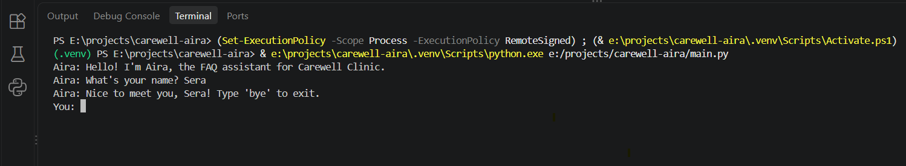
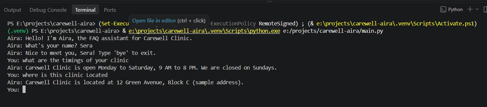
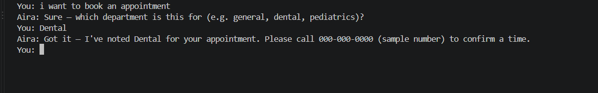
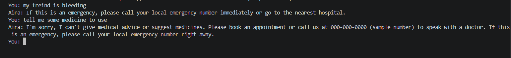

# Aira: A FAQ Chatbot for Carewell Clinic

A rule-based chatbot I built for the DecodeLabs AI Internship, Project 1 (Rule-Based AI Chatbot).

> Carewell Clinic isn't real. Every name, address, and contact detail in this project is sample data made up for the assignment.

> Aira doesn't give medical advice and isn't a substitute for one. Anything about medicines, dosage, symptoms, or treatment gets a dedicated response that points the user to book an appointment or call the clinic instead. Anything that sounds like an emergency gets caught before the rest of the message is even looked at.

## Requirements

- Python 3.8 or newer
- No external packages are needed to run the chatbot (pytest is only needed for the tests)

## Features

- Runs in a continuous loop until an exit command is typed
- Cleans up input (lowercase, extra whitespace) before checking it
- Dictionary-based knowledge base covering 9 intents
- Falls back to a default message for anything it doesn't recognize
- Checks for emergencies first, before anything else in the message
- Refuses to give medical advice and points to the clinic instead
- Asks a short follow-up question after booking an appointment
- Greeting replies are randomized so they don't feel repetitive
- Comes with 23 passing tests written with pytest

## Quick Start

```bash
git clone https://github.com/YOUR-USERNAME/carewell-aira.git
cd carewell-aira
python main.py
```

Aira asks for your name once, then you can start chatting. Type `bye`, `exit`, `quit`, or `goodbye` to leave, or press Ctrl+C.

No installation is needed to run the chatbot itself, because it uses only Python's standard library. You need Python 3 installed.

## Running the Tests (optional)

The tests need pytest. A virtual environment keeps it separate from your other projects:

**Windows**
```bash
python -m venv .venv
.venv\Scripts\activate
pip install -r requirements.txt
python -m pytest -v
```

**macOS / Linux**
```bash
python3 -m venv .venv
source .venv/bin/activate
pip install -r requirements.txt
python -m pytest -v
```

## Folder Structure

```
carewell-aira/
├── aira/
│   ├── __init__.py
│   ├── config.py            # Bot and clinic constants, exit commands, fallback message
│   ├── preprocessing.py     # clean() - lowercases, strips punctuation and whitespace
│   ├── knowledge_base.py    # RESPONSES, GREETINGS, KEYWORDS dictionaries
│   ├── intent_matcher.py    # find_intent(), is_exit_command()
│   └── chat_session.py      # get_response(), run_chat()
├── tests/
│   └── test_intent_matcher.py
├── docs/
│   └── screenshots/
├── main.py
├── requirements.txt
├── .gitignore
└── README.md
```

## Design Decisions

### Why a dictionary instead of an if-elif chain
I used a dictionary with `.get()` for responses instead of a long if-elif chain, which is what the course material asked for. It also means adding a new intent is just one new entry in a dictionary, not another elif branch, and `RESPONSES.get(intent, FALLBACK_MESSAGE)` handles a missing intent in a single line without ever raising a KeyError.

### Following the IPO model
The project follows Input, Process, Output. Input is the single `input()` call inside `run_chat()`. Process is everything that happens next: `clean()`, `find_intent()`, and `get_response()`. Output is the `print()` call, also inside `run_chat()`. Keeping `get_response()` free of any `input()` or `print()` calls is what makes it possible to test directly, without anyone typing anything by hand.

### Emergencies are always checked first
`find_intent()` scans every word in the message for emergency keywords before looking at anything else, and returns "emergency" the moment it finds one. That means something like "hi this is urgent" or "book urgent appointment" comes back as emergency, not greeting or appointment.

### Why that trade-off is worth it
A keyword-based bot can't understand a word like "not," so a message like "I want an appointment, it's not urgent" still triggers the emergency response. That's on purpose. A false alarm costs a few extra seconds, but missing a real emergency could cost someone's life, so the bot is built to lean toward caution.

### No medical advice, ever
Questions about medicine, dosage, symptoms, or treatment go to a separate "medical" intent that declines to answer and redirects the user to book an appointment or call the clinic, instead of falling through to the generic fallback message. Emergency keywords still win over this: "urgent i need my tablets" comes back as emergency, not medical.

### Why .strip() runs last in clean()
Punctuation gets removed before whitespace, because stripping punctuation can leave a trailing space behind, like turning "hello !" into "hello ". If strip() ran first instead, that trailing space would stick around and break exact matches against the keyword dictionary.

### Greeting and thanks sit at the lowest priority
Both come up a lot, but they're rarely what the message is actually about, so `find_intent()` remembers whichever one shows up first while it keeps looking for something more specific. It only falls back to greeting or thanks if nothing else matches. That's why "hi, what are your timings?" answers the hours question instead of just greeting back, and "thanks, what are your fees?" goes straight to the fees answer.

### Exit only matches the full message
`is_exit_command()` checks the whole cleaned message against the exit list, so something like "can I quit my appointment" won't accidentally close the bot. At the same time, the exit check happens before anything else in the main loop, so typing "bye" always works right away, even in the middle of the department follow-up.

### Handling empty input
Pressing Enter with nothing typed, typing only spaces, or typing something like "?!?!" (which `clean()` turns into an empty string) triggers a short prompt asking the user to type something, using `continue`. It doesn't fall back to the default message, which is meant for input that's real but just not recognized.

### The if __name__ == "__main__" guard
This lets the test suite import `main.py` without the chat loop starting on its own, since Python only runs the code under that line when the file is run directly.

### Random greeting replies
Greetings live in their own `GREETINGS` list instead of inside `RESPONSES`, since a dictionary value has to be one string, not a list of options. `get_response()` checks for the "greeting" intent specifically and calls `random.choice(GREETINGS)` for it, then falls back to the normal `RESPONSES.get()` lookup for everything else.

### Asking for the user's name
The name is captured once before the main loop starts, using just `.strip()` instead of `clean()`. A name only ever gets echoed back in a greeting and is never matched against a keyword dictionary, so there's no reason to lowercase it or strip out punctuation.

### The department follow-up
Once an appointment intent is detected, Aira asks which department and sets a flag called `awaiting_department` to True. That flag carries over into the next loop, so the very next thing typed is treated as a department name (using the raw input, not the cleaned version) and skips intent matching completely. After that, the flag resets back to False. It's the only spot in the whole bot where one turn changes how the next one gets read.

### Handling Ctrl+C
`main()` wraps `run_chat()` in a try/except that only catches `KeyboardInterrupt`, not a bare except, so an actual bug still shows up as a real error instead of getting hidden. Pressing Ctrl+C now prints a clean goodbye message instead of crashing with a traceback.

## Limitations

- Matching is exact, word for word. "medicine" and "medicines" need to be listed separately in KEYWORDS, and typos or synonyms that aren't already there won't be picked up on their own, though a sentence often still gets matched through another correctly spelled keyword.
- Only single words are matched, not phrases.
- Within the same priority level, whichever word shows up first in the message wins. "hi thanks" comes back as greeting, "thanks hi" comes back as thanks.
- There's no concept of negation or context, which connects back to the safety trade-off above. The bot can't tell "I need an appointment" apart from "I don't need an appointment."
- The department follow-up accepts literally anything typed after it. It isn't checked against a real list of departments, so a typo or an unrelated word gets acknowledged the same way a real department name would.

## Example Conversation

Screenshots from a sample run are saved in `docs/screenshots/`.

### Startup and name prompt


### A normal question being answered


### Booking an appointment, then the department follow-up


### The emergency and medical safety response


---

Built for the DecodeLabs AI Internship, Project 1, Batch 2026.